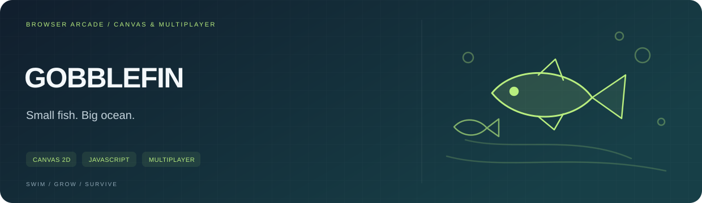

<p></p>

**작은 물고기에서 시작해 바다의 경쟁자로 성장합니다.** 설치 없이 브라우저에서 즐기는 Canvas 기반 웹 아케이드입니다.

<p><a href="https://gobblefin-reef-arena.hazy-skink-6279.chatgpt.site"><b>바로 플레이</b></a> &nbsp; / &nbsp; <a href="#플레이-방법"><b>플레이 방법</b></a> &nbsp; / &nbsp; <a href="#코드-구성"><b>코드 구성</b></a> &nbsp; / &nbsp; <a href="LICENSE"><b>라이선스</b></a></p>

<table><tr><td width="33%" valign="top"><b>SWIM</b><br><sub>마우스·터치로 자유롭게 이동</sub></td><td width="33%" valign="top"><b>GROW</b><br><sub>먹고 성장하고, 대시로 돌파</sub></td><td width="33%" valign="top"><b>COMPETE</b><br><sub>닉네임·순위·코인·스킨 상점</sub></td></tr></table>

---

# GOBBLEFIN

작은 물고기는 먹고 큰 물고기는 피하세요. 경쟁자 AI, 실시간 순위와 물고기 디자인 상점이 있는 브라우저 게임입니다.

## 플레이 방법

| 입력 | 동작 |
| --- | --- |
| 마우스 / 터치 | 이동 방향 조종 |
| 클릭 유지 / `Space` | 대시 · 점수 일부 소모 |
| `P` / `Esc` | 일시정지 |

보물상자와 라운드 순위 보상으로 코인을 모아 6종 물고기 디자인을 구매할 수 있습니다. 데스크톱·모바일을 지원하며 최고 점수는 브라우저에 저장합니다.

## 게임 구성

- Canvas 게임 루프, 성장·대시와 포식 판정
- 닉네임 기반 멀티플레이, 접속자·실시간 순위
- 경쟁자 AI, 치어 무리와 서버 충돌 판정
- 코인 보상과 물고기 디자인 상점

## 코드 구성

| 위치 | 역할 |
| --- | --- |
| [`dist/client/index.html`](dist/client/index.html) | 게임 화면 |
| [`dist/client/game.js`](dist/client/game.js) | Canvas 렌더링·입력·클라이언트 상태 |
| [`dist/client/style.css`](dist/client/style.css) | 화면·모바일 레이아웃 |
| [`dist/server/index.js`](dist/server/index.js) | 플레이어 상태·게임 API |
| [`dist/server/wrangler.json`](dist/server/wrangler.json) | Worker의 정적 자산·D1 연결 설정 |
| [`drizzle/`](drizzle) | 멀티플레이 데이터 스키마 |

## 로컬에서 살펴보기

이 저장소에는 배포용 클라이언트·서버 파일이 들어 있습니다. `dist/client`를 정적 서버로 제공하면 화면과 클라이언트를 살펴볼 수 있습니다.

```bash
python -m http.server 8080 --directory dist/client
```

브라우저에서 `http://localhost:8080`을 엽니다. 멀티플레이 API는 별도 Worker·D1 실행 환경이 필요하므로 정적 미리보기만으로 전체 서버 기능이 재현되지는 않습니다. 전체 플레이는 위 배포 링크를 이용해 주세요.

## 라이선스

[MIT](LICENSE)
